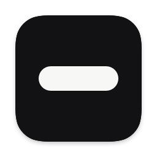

<p align="center">
  
</p>

<h1 align="center">Notcher</h1>

<p align="center">
  A Dynamic Island for the Mac. Notcher turns the MacBook notch into a live, interactive surface
  for what's playing, system HUDs and device notifications.
</p>

<p align="center">
  
  
  
  
</p>

---

## Features

### The island
- A black island drawn over the notch that grows on hover, squashes on press, and opens into a
  full panel, all on springs tuned to feel physical.
- Opens on hover (with an optional delay) or on click.
- Trackpad haptics on hover, press and gesture thresholds.

### Now Playing
- **Live activity:** artwork beside the notch and a waveform tinted from the artwork's colours.
- **Quick peek:** the new title slides out under the notch when the track changes.
- **Player:** artwork, scrolling title, scrubbable progress bar, previous / play-pause / next,
  shuffle, and an output-device row with a volume slider.
- **Track transitions:** the title blurs across, the artwork flips, and the skip arrows animate,
  whether you click or swipe. The previous cover stays up until the new one has loaded.
- **Sources:** Automatic, System (any app that reports now playing, including browsers), Apple
  Music, or Spotify. When the main player is paused, another app that is playing is shown instead.

### Gestures
Two-finger trackpad swipes on the island, with rubber-band resistance and a haptic at the threshold:

| Gesture | Action |
|---|---|
| Swipe down on the closed island | Open it |
| Swipe up on the open island | Close it |
| Swipe up on a live activity | Dismiss it until something new plays |
| Swipe left / right | Previous / next track |

Each gesture can be turned off, and *Natural movement* sets whether the island follows your fingers
or your scroll direction.

### System HUDs
- **Volume:** replaces the macOS volume overlay. It shows the output device (with 3D renders for
  AirPods) and stretches when you press past 0 % or 100 %.
- **Battery:** notifications for charging, low battery (with a threshold) and Low Power Mode.

### Connectivity
- An animated popup when AirPods or other Bluetooth audio devices connect, with the model's render
  (or a symbol) and a battery ring that turns red below a threshold.

### Displays
- Shows on the built-in display, the main display, all displays, or a specific one.
- On displays without a notch it draws a compact pill, or a simulated notch if you prefer.
- Fine-tune the notch size in 1 pt steps, and hide the island over fullscreen apps.

### App
- A native Settings window, launch at login, and an optional hidden menu bar icon.

## Requirements

- macOS 15 Sequoia or later
- A Mac with Apple silicon. A notch is optional: other displays get a pill.

## Installation

1. Download the latest `Notcher-<version>.dmg` from
   [Releases](https://github.com/RishivikramN/notcher/releases).
2. Open it and drag **Notcher** to **Applications**.
3. Launch Notcher. It lives in the menu bar; open **Settings…** from there.

Releases are signed with a Developer ID and notarized by Apple, so they open without Gatekeeper
warnings.

### Permissions

Notcher asks for each permission the first time a feature needs it.

| Permission | Used for |
|---|---|
| Accessibility | Reading the volume keys so the volume HUD can replace the system one |
| Automation (Music, Spotify) | Showing artwork and position, and controlling playback for those apps |
| Bluetooth | Detecting connected audio devices and reading their battery levels |

Everything runs on your Mac. Notcher makes no network requests except to load Spotify artwork.

## Building from source

Requirements: Xcode 16 or later (Swift 6 toolchain) and an Apple Developer signing identity.

```sh
git clone git@github.com:RishivikramN/notcher.git
cd notcher
./run.sh            # debug build, assembled into build/Notcher.app, then launched
./run.sh release    # optimised build
./run.sh --no-open  # build without launching
```

`run.sh` builds the Swift package, assembles the app bundle from `Support/Info.plist` and
`Resources/`, compiles the MediaRemote adapter, signs everything and relaunches the app. It signs
with your `Apple Development` identity by default; set `NOTCHER_SIGN_IDENTITY` to use another one.

Debug builds add a **Debug** menu (display-mode override, animation tuning, a now-playing
inspector) and a dry-run mode for testing media commands without touching your player.

### Releasing

```sh
./release.sh --version 1.1.0
```

This sets the version and bumps the build number, builds a release, signs it with Developer ID
(Hardened Runtime), packages `dist/Notcher-1.1.0.dmg`, notarizes and staples it, verifies it with
Gatekeeper, then commits the version and tags `v1.1.0`. Use `--skip-notarize` for a local signed
build.

Notarization needs a one-time keychain profile:

```sh
xcrun notarytool store-credentials notcher-notary \
  --apple-id <your Apple ID> --team-id <your team ID>
```

## Project structure

```text
Sources/
  Notcher/
    App/          App lifecycle, settings model and window, menu bar item
    Window/       The notch panel, per-display geometry and sizing
    Island/       Island state machine and every view: shape, player, HUDs, transitions
    Gestures/     Trackpad swipe tracking and rubber-band maths
    Media/        Now-playing model and sources (system, Music, Spotify)
    Audio/        Output device, volume and product identification
    System/       Media keys, battery, Bluetooth, fullscreen and Accessibility
    Debug/        Animation tuning and inspectors (debug builds only)
  MediaRemoteAdapter/
    adapter.m     Streams system now-playing data as JSON
Resources/        Product renders, sounds, icons and the asset catalog
Support/          Info.plist, entitlements, icon generator
run.sh            Build and run
release.sh        Sign, package, notarize and tag a release
```

### How it works

- **The island** is a borderless, non-activating panel just above the menu bar, sized once for the
  largest state, so it never resizes mid-animation. One `@Observable` controller per display owns
  the state, and every change happens inside a spring animation.
- **Now playing** comes from the private MediaRemote framework. macOS only gives that data to
  Apple-signed processes, so a small adapter dylib is loaded into `/usr/bin/perl` and streams JSON
  back to the app. Music and Spotify are also read over AppleScript for artwork, position and
  shuffle.
- **The volume HUD** uses an active `CGEvent` tap on media keys, which lets Notcher handle the key
  and suppress the system overlay.
- **Haptics** drive the trackpad's actuator directly, because the public haptics API only plays
  for the frontmost app.

## Known limitations

- Notcher relies on private macOS frameworks (MediaRemote, MultitouchSupport, CoreGraphics Spaces).
  Each feature fails quietly if one changes, but a macOS update can break it. For the same
  reason Notcher can't be distributed through the Mac App Store.
- macOS only routes playback commands to the system's current now-playing app. When another app is
  shown because the main player is paused, its controls are disabled unless it is Music or
  Spotify.

## License

Copyright © 2026 Rishivikram Nandakumar. All rights reserved.
